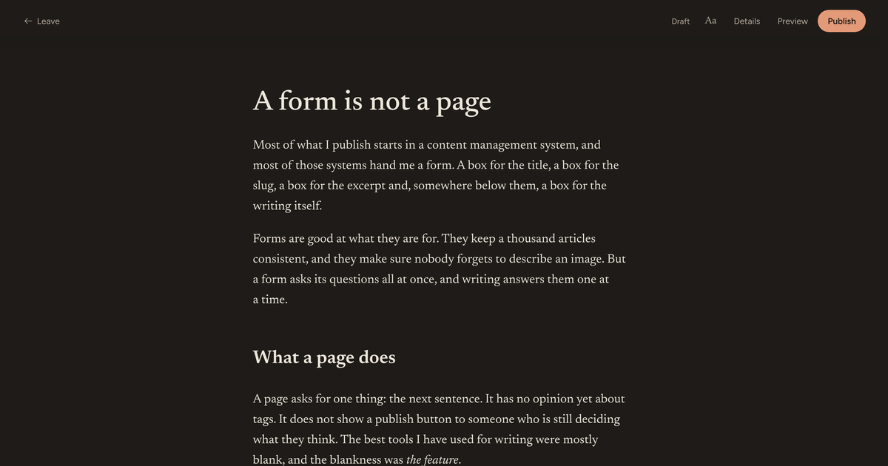

# sanity-plugin-writing-room

A calm, full-screen place to write long-form content inside Sanity Studio: Posts, articles, case studies, whatever your Studio writes.

[](https://writingroom.studio)

**[writingroom.studio](https://writingroom.studio)** has the docs, more pictures and a short film of the room in use.

Most Studios put writing in a form: panes, field labels and a toolbar around every sentence. The Writing Room is a Studio Tool with its own route that shows only a document's title and body, and gets out of the way while you type. Everything else (slug, excerpt, cover image, tags, any field of your own) is under **Details**: one click swaps the body for those fields, without leaving the room. It works with the document types you already have.

- **The Lobby**: a doorway, not a document browser. Continue the piece you were last in, start something new, or pick from a few recent ones. The Studio's navbar stays above it, and Structure is one link away for everything else.
- **Controls that recede**: Leave on one side; status, Details, Preview and Publish on the other. They fade after a few keystrokes and return when you pause. The word count sits at the foot of the page, and anything the room needs to tell you appears there too.
- **Formatting on selection**: bold, italic, headings, quotes and links in a small bubble above selected text.
- **An insert menu**: click the `+` beside an empty line, or type `/`, for images (uploaded, or chosen from the image sources your Studio already has), embeds (YouTube, Vimeo, Spotify), code blocks, section breaks, quotes and lists.
- **Markdown as you type**: `##`, `>`, `-`, `1.`, `---` and code fences.
- **Room settings**: one `Aa` menu for text size, typewriter scrolling and focus dimming (kept per Writer in the browser, no setup), dark mode and fullscreen.
- **Any screen**: on a phone or a narrow window the controls keep to Leave, `Aa` and Publish, and the rest moves into the `Aa` menu.
- **Live sync and presence** through the Sanity App SDK. The room says when you're offline and keeps your words until you're back.
- **Publish from the room**: the slug is settled and the date stamped for you. If something blocks the publish, the room takes you straight to it; if nothing does, it shows where the document will go live and asks once. Afterwards, a link to the live page (when `preview` says where your site is).
- **Or schedule it**: where your Studio has [scheduled drafts](https://www.sanity.io/docs/studio/scheduled-drafts), the same panel offers a time instead. A scheduled document is locked and shows exactly what will go live; unlock it to change the words or the time. See [Scheduling](#scheduling).
- **Preview** opens the document on your site in draft mode, exactly as readers will see it.

> **Status: 0.x.** The API may change before 1.0; breaking changes are listed in the [changelog](https://github.com/mematthew123/sanity-plugin-writing-room/blob/main/CHANGELOG.md). What's next is in the [roadmap](https://github.com/mematthew123/sanity-plugin-writing-room/blob/main/ROADMAP.md).

## Requirements

The plugin runs inside Sanity Studio. It doesn't care what your website is built with.

| You need | Version | Why |
|---|---|---|
| Sanity Studio | `sanity` 6.22 or newer (v6) | The version the room is written and tested against. Older 6.x releases are being checked (see [Compatibility](#compatibility)). |
| React | 19.3.1 or newer | Required by `@portabletext/editor` 8. |
| Node.js | 22.12 or newer | Required by Sanity Studio v6 to run `sanity dev` and `sanity build`. |
| Studio auto-updates | **Off** | See [Why auto-updates off?](#install). |

**Do I need Next.js?** No. The room only needs a Studio. Next.js matters only if you turn on **Preview**, and even then any site can do it (see [Preview on your site](#preview-on-your-site)).

## Install

Three steps, from your Studio's folder.

**1. Add the package.**

```sh
npm install sanity-plugin-writing-room
```

**2. Add the plugin, with the document types you write in.**

```ts
// sanity.config.ts
import {writingRoom} from 'sanity-plugin-writing-room'

export default defineConfig({
  // …
  plugins: [structureTool(), writingRoom({types: ['post']})],
})
```

**3. Turn off Studio auto-updates.**

```ts
// sanity.cli.ts
export default defineCliConfig({
  // …
  deployment: {autoUpdates: false},
})
```

That's all. Run `sanity dev`: **Writing Room** appears in the Studio's navigation, and each of those documents gets an **Open in Writing Room** action.

**Which types?** Your own `post`, `article`, `caseStudy`… The room finds each one's title, body, slug and published date by itself (see [Document types](#document-types)) and only offers what its body can store. No Post type yet? Register the starter one: `schema: {types: writingRoomSchemaTypes}` (see [Schema](#schema)).

**Starting from scratch?** [Calm Editor](https://github.com/mematthew123/calm-editor) is a template with a Studio, the Writing Room and a Reading Site in the same typography and colour: both ends of a blog at once.

**Why auto-updates off?** The room uses Sanity's App SDK (`@sanity/sdk-react`). An auto-updating Studio loads `sanity` from a CDN but bundles its own copy of the SDK, so the two never share a React context and the room can't start. This only shows up in a **deployed** Studio, not in `sanity dev`. To upgrade later, bump `sanity` and deploy again.

## Look and feel

The room brings its own look, and none of it reaches the rest of your Studio:

- **Fonts.** Newsreader (prose, with a true italic) and Figtree (controls) come with the plugin, Latin and Latin Extended, and load the first time the room opens. Nothing to install. Other scripts fall back to Georgia and the system UI font.
- **Colours.** The room's paper, warm neutrals and clay accent apply inside the room only. The accent (links, the caret, focus rings, Publish) is the one colour you can change, to match your brand:

  ```ts
  writingRoom({
    types: ['post'],
    accent: '#2F6FA8',
  })
  ```

  Give one hex colour and the room uses it in light and dark, adjusting it where it has to so it stays readable on the room's paper (WCAG AA), and works out the selection highlight and the text on Publish from it. To choose each yourself: `accent: {light: '#2F6FA8', dark: '#8DB8E0'}`.

### A matching Studio theme (optional)

To give the rest of the Studio the room's colours and Figtree, so moving in and out of the room isn't a jolt, use the theme. It needs `@sanity/themer`:

```sh
npm install @sanity/themer
```

```ts
import {writingRoomTheme} from 'sanity-plugin-writing-room/theme'

export default defineConfig({
  // …
  theme: writingRoomTheme,
})
```

If you changed the room's accent, build the theme from the same one: `theme: createWritingRoomTheme({accent: '#2F6FA8'})`.

## What the plugin adds

- the **Writing Room** Tool at `/writing-room`, with a Lobby to continue or start from;
- an **Open in Writing Room** action on the room's document types (Posts, by default). Leave then takes you back to that document's form; from the Lobby, back to the Lobby;
- a wrapper around the built-in **Publish** on those types, so a document published from the form gets the same settled slug and published date as one published from the room.

## Document types

The room writes Posts by default. To write other kinds too, list their document types:

```ts
writingRoom({
  types: ['post', 'caseStudy'],
})
```

### Fields

The room reads each type's schema to find what it writes:

| | It looks for | If there's none |
|---|---|---|
| Title | `title`, else the field the type's preview shows as its title, else the first string field | The type is left out |
| Body | `body`, else `content`, else the first portable text field | The type is left out |
| Slug | `slug`, else the first slug field | No slug is settled on publish |
| Published date | `publishedAt`, else the first date field whose name contains "publish" | No date is stamped on publish |
| Cover image | `coverImage`, else `mainImage`, else the first image field | No "Add a cover image" nudge after a publish |

If it guesses wrong, name the field: `{type: 'article', fields: {body: 'content', title: 'headline'}}`. Every other field (excerpt, tags, a client name…) shows up under **Details**, with nothing to configure.

### Details

**Details** in the room's controls swaps the body for the document's other fields, on one page in the order your schema gives them. The title stays where it is, and the arrow or Esc goes back to the writing.

- **Simple fields get the room's own inputs**: strings, text, numbers, booleans, dates, slugs and tag lists.
- **Everything else is Sanity's own input**, looking as it does in the rest of your Studio: references, images, files, arrays of objects, and lists of choices. With the [matching theme](#a-matching-studio-theme-optional) they sit closer to the room's look.
- **Your custom inputs are used as they are.** A field with its own `components.input` or `components.field` is never replaced.
- **List the Writing Room last in `plugins` if another plugin wraps every input.** For simple fields the room's inputs take the place of Sanity's, which ends Sanity's chain of input components there. A plugin listed before the Writing Room still wraps the room's inputs in Details; one listed after it, and a `form.components.input` in your own Studio config, does not. Everything still appears in the Structure form.
- **Your schema's rules apply**: `hidden`, `readOnly` and validation behave as they do in the standard form. Field groups are not shown as tabs; fieldsets are kept.
- A type with only a title and a body has no Details button.

Details are saved as you type, like the writing. If a required field blocks a publish, the room opens Details at that field.

If the Details view can't be shown in your Studio, the room says so and offers **Open in Structure** instead.

### The body

The editor is built from the body field's own type, so the room only offers what that type can store. A `blockContent` with headings, quotes, bullets, links and images gets exactly those: no code blocks, embeds or numbered lists in the Insert Menu, selection bubble or markdown shortcuts. Image description and caption inputs appear only when your image type has `alt` and `caption` fields.

**Choose an image** in the Insert Menu offers the same image sources as the **Select** menu on an image field in your Studio: the Studio's own uploads, Media Library if you've turned it on, and any a plugin adds. There is nothing to set up. The room follows `form.image.assetSources` and `form.image.directUploads` in your Studio config, and `options.sources` and `options.disableNew` on the body's image type, so a row the Studio wouldn't offer isn't offered in the room either. Each source opens in its own dialog, in your Studio's theme.

To offer the room's own blocks (YouTube/Vimeo/Spotify embeds, code blocks, section breaks), add them to your body type. The plugin registers them for you, under prefixed names that can't clash with yours:

```ts
import {writingRoomBlocks} from 'sanity-plugin-writing-room'

defineType({
  name: 'blockContent',
  type: 'array',
  of: [{type: 'block'}, {type: 'image'}, ...writingRoomBlocks],
})
```

Your site then renders them as `writingRoomEmbed`, `writingRoomCodeBlock` and `writingRoomSectionBreak`. (The starter `writingRoomSchemaTypes` uses the original names, `embed`, `codeBlock` and `sectionBreak`; the room handles both.)

Blocks of your own that the room doesn't know (a `callout`, a product card…) keep their place in the text as a quiet placeholder: the Writer can move or delete them, and **Edit in Structure** opens that block in the standard form.

### Labels and URLs

The Lobby's **New** button starts a document of your type ("New Post"); with several types it asks which. Recent writing lists them together. The room names each type with its schema `title` ("Case Study"). If a name comes out wrong, set it yourself:

```ts
writingRoom({
  types: ['post', {type: 'news', title: 'News', pluralTitle: 'News'}],
})
```

| Option | Default | What it does |
|---|---|---|
| `types` | `['post']` | The document types the room writes, as names or `{type, title?, pluralTitle?, fields?}`. |
| `types[].title` | the schema type's `title` | What one is called: "New Case Study". |
| `types[].pluralTitle` | `title` made plural | What several are called: "Case Studies". |
| `types[].fields` | detected | `{title?, body?, slug?, publishedAt?, image?}`: field names, when the room guesses wrong. |

The first type is the default: its documents open at `/writing-room/<id>`, the others at `/writing-room/<type>/<id>`. A Studio with one type keeps short URLs, and links to it keep working if you add more types later, as long as it stays first.

If a type in `types` isn't in your schema, or has no title or body the room can find, the room leaves it out and says why in the browser console. Slugs are unique within a type, so a Post and a Case Study can both be `hello-world`.

## Schema

You don't need the plugin's schema if you already have a type to write in: the room works with yours. `writingRoomSchemaTypes` is a starter for Studios that don't: a `post` with a `body` that has everything the room can do (images with descriptions and captions, embeds, code blocks, section breaks). Each is also exported on its own (`post`, `body`, `embed`, `codeBlock`, `sectionBreak`) if you'd rather compose them.

The plugin doesn't register these types for you, on purpose. `post` and `body` are common names, and a clash would stop your Studio from starting, so you add them where you can see them.

Only Prose (title, body, and alt text on body images) should *block* a publish, because the Writer can't fix anything else from inside the room. Publishing from the room is a real publish: webhooks and Functions that listen for it run as usual.

## Scheduling

There is nothing to set up. The room schedules with Sanity's own [Scheduled Drafts](https://www.sanity.io/docs/studio/scheduled-drafts), so it offers **Schedule for later** wherever your Studio has them (a paid plan, and `scheduledDrafts.enabled` not turned off in your config) and says nothing about scheduling where it doesn't. What the room schedules shows up in Studio's scheduled drafts list, and the other way round.

- **The date.** A document with no published date gets the time it goes live, not the time someone clicked Schedule. A date the Writer set is left alone.
- **Locked while scheduled.** The room shows the scheduled version, read-only: the title, the body and Details. Typing says why nothing happens.
- **Unlock to change it.** Unlock takes the document off the schedule and hands the Writer what was about to go live, as an ordinary draft. Scheduling again opens on the time it had. If the room stamped the published date, Unlock clears it, so the next schedule or publish stamps the right one.
- **Schedules left hanging.** A schedule paused in Studio, or one that never finished being made, won't go live. The room says so ("Not scheduled · won't go live") and stays locked until the Writer unlocks it.

Four things worth knowing:

- Scheduling from Studio's own form ("Schedule publish") doesn't settle the slug or stamp the published date the way the room does, and the way the plugin's wrapper does for Publish. Studio adds that action after every plugin has run, so a plugin can't wrap it. Schedule from the room when those matter.
- The room's lock is the room's. Studio keeps its own behaviour, including "Pause to edit". If someone edits the scheduled version there, the room shows their edits; if they edit the draft underneath instead, those edits are replaced by the scheduled version at Unlock (they stay in the document's history).
- A document unlocked in the room is not listed under Studio's Paused tab: the room removes the schedule rather than pausing it.
- Scheduling takes three requests to Sanity. If your connection drops between them, the room tells the Writer the document isn't scheduled rather than guessing.

## Sorting a pasted piece (experimental)

Off unless you set it up. When a Writer pastes a whole piece written elsewhere (Google Docs, Notion, Word) into an empty document, the room offers once to sort it: the headline becomes the title, and the rest goes where it belongs in Details. Every field is a candidate except the published date.

Sorting never writes. It moves the Writer's own words into fields, and for a field with set answers (an author, a category, a list of options) it picks among the answers that already exist. A field the paste has nothing for stays empty.

It is experimental: the option, the route and the request between them may change in a minor release.

### Setting it up

The judging is done by TypeSafe's [Jev](https://vercel.com/ai-gateway/models/typesafe-ai/jev) through [Vercel AI Gateway](https://vercel.com/docs/ai-gateway), which needs a credential that can't live in the browser. So you host one route, and the plugin ships its handler.

1. **Add the route** to a server you run. In a Next.js app:

   ```ts
   // app/api/sort/route.ts
   import {createSortingHandler} from 'sanity-plugin-writing-room/sorting'

   const handler = createSortingHandler({
     projectId: 'your-project-id',
     // Only when the Studio is on a different origin from the route:
     origins: ['https://your-studio.sanity.studio'],
   })

   export {handler as POST, handler as OPTIONS}
   ```

   Install [`ai`](https://www.npmjs.com/package/ai) (7.0.128 or later) beside it. The handler takes a web `Request` and returns a `Response`, so it works anywhere those do.

2. **Give it access to the gateway.** Deployed on Vercel, it uses the deployment's own token and needs nothing. Anywhere else, including locally, set `AI_GATEWAY_API_KEY`.

3. **Tell the room where the route is:**

   ```ts
   writingRoom({types: ['post'], sorting: {endpoint: '/api/sort'}})
   ```

### What a Writer sees

- **The paste lands as usual.** If the body was empty and the paste is a piece (three blocks and about 150 words, at least), a line at the foot offers to sort it. Ignoring it or typing on leaves an ordinary paste. The first time, the offer says the text will go to the AI service the Studio has set up.
- **The page is held** for a moment while it's sorted, usually under a second. Esc stops it. If it can't be done, the paste is left exactly as it was.
- **Then the room says what it filled**, with **See Details** and **Undo**. Filled fields are marked "From your paste" in Details. Undo puts the paste back as it landed, and lasts until the first edit.

### What it fills

| Field | How |
| --- | --- |
| Title | The headline, unless the Writer already typed a title. |
| String and text fields | A block written to be that field: a standfirst for an excerpt. It is moved out of the body. |
| A reference, or a string with a list of options | One of the existing answers: by what the paste states ("By Sam Okafor"), or by what the piece is about. |
| An array of references, or of strings with a list | Several of the existing answers, the same way. |
| Tags with no set list | The items of a label line ("Tags: portugal, city breaks"), as written. |

Good to know:

- **Field titles and descriptions matter.** They are what tells the model what a field is for. A text field described as "Not shown on the site" is left alone; an undescribed one is harder to judge.
- **It leaves these alone:** the slug (it follows the title), the published date, images, booleans, numbers, dates, objects, a reference with a `filter`, a field with a `hidden` or `readOnly` rule or an input component of its own, a set of more than 254 answers, and any field that already has something in it.
- **A line only leaves the body when it was used in full.** "By Dana Whitfield" stays if there is no such author; a tags line stays if it names a tag the field doesn't offer.
- **Long lists of answers are filled from a label line only.** Judging an array field by what the piece is about costs one question per answer, and a sort spends at most 60 of them, on fields in schema order. A `tags` field with 200 tags is still filled from "Tags: portugal, city breaks", but not by judgement.
- **It would rather leave a field empty than guess.** An empty field shows; a wrong one doesn't.
- **Only members of your project can call the route.** The room sends the Writer's Sanity token and the route checks it with Sanity before asking the model. That means Sorting needs a sign-in that has a token: a Writer signed in by cookie isn't offered it (the browser console says so once). Setting `auth: {loginMethod: 'token'}` in your Studio config makes sure there is one.
- **What reaches the model:** the first dozen and last few blocks of the paste, about 2,000 characters of what follows, your field titles and descriptions, and the names of the answers to pick from. Images are never sent, and neither are document ids: your route keeps those and hands the model short stand-ins.
- **Cost.** A fraction of a cent per sort at the gateway's listed price for Jev.

## Preview on your site

Preview opens the document on your site in draft mode, unpublished changes included. It's off until you give it your site's origin:

```ts
writingRoom({
  preview: {
    origin: 'https://example.com',
    pathname: (slug) => `/blog/${slug}`, // default: /posts/<slug>
  },
})
```

| Option | Default | What it does |
|---|---|---|
| `preview.origin` | — | Your site's origin. Setting `preview` turns on the room's Preview button. |
| `preview.enablePath` | `/api/draft-mode/enable` | The route that checks the preview secret and turns on draft mode. |
| `preview.pathname` | `/posts/<slug>` for `post`, `/<type>/<slug>` for other types | `(slug, type) => path`: where a document is read on your site. |

With more than one type, use the second argument:

```ts
pathname: (slug, type) => (type === 'caseStudy' ? `/case-studies/${slug}` : `/blog/${slug}`)
```

The room creates a one-hour preview secret and opens `<origin><enablePath>?sanity-preview-secret=…&sanity-preview-pathname=…`. Your site needs a route there that validates the secret and redirects:

- **Next.js** (App Router): use `next-sanity`.

  ```ts
  // app/api/draft-mode/enable/route.ts
  import {defineEnableDraftMode} from 'next-sanity/draft-mode'
  import {client} from '@/sanity/client'

  export const {GET} = defineEnableDraftMode({
    client: client.withConfig({token: process.env.SANITY_API_READ_TOKEN}),
  })
  ```

- **Anything else** (Astro, Nuxt, SvelteKit, Remix…): call `validatePreviewUrl(client, request.url)` from `@sanity/preview-url-secret`, turn on your framework's draft or preview mode, and redirect to the `redirectTo` it returns.

Either way the site needs a Viewer token to check the secret, and its origin must be a CORS origin of your Sanity project.

## Troubleshooting

**"The Writing Room can't start in this Studio yet."** The room and the Studio are using different copies of Sanity's App SDK. On a deployed Studio, turn off auto-updates ([Install](#install), step 3) and deploy again. In `sanity dev`, run `npm ls @sanity/sdk-react`: it should appear at a single version. If you've linked the plugin (`npm link`, `file:`, a workspace) instead of installing it, add `sanity`, `react`, `react-dom`, `@sanity/sdk-react` and `@portabletext/editor` to Vite's `resolve.dedupe` in `sanity.cli.ts`.

**A Content Security Policy with a nonce.** The room puts its styles on the page in `<style>` elements. If your policy allows styles by nonce, state the nonce in `<meta property="csp-nonce" nonce="…">` in the page's head (or set webpack's `__webpack_nonce__`), which is where styled-components looks for it too, and the room adds it to its own.

**Yarn, or two copies of the SDK.** npm (7+) and pnpm install the plugin's peer dependencies for you, and share `@sanity/sdk-react` and `@portabletext/editor` with Sanity when your `sanity` version is in range. Yarn doesn't install peers: add `@sanity/sdk-react@^3.12.0` and `@portabletext/editor@^8.2.12` yourself. To check, run `npm ls @sanity/sdk-react @portabletext/editor`: each should appear at a single version.

**A type is missing from the Lobby.** Open the browser console: the room says why it left a type out (not in the schema, or no title or body it could find). Name the field with `fields` if it guessed wrong.

## Compatibility

`npm run smoke` (in this package) packs the plugin, installs it with npm into a brand-new Studio and checks that:

1. it installs with no peer-dependency conflicts,
2. there's exactly one copy of `@sanity/sdk-react`, `@sanity/sdk`, `@portabletext/editor` and `react`, and of every `@portabletext/*` package,
3. a `sanity.config.ts` using the plugin and its theme type-checks against the published types,
4. `sanity build` bundles the Studio with exactly one copy of the App SDK, and with the room's styles and the keyframes of every animation in them,
5. with `--embedded`, the same Studio embedded in a Next.js App Router app (`next-sanity`'s `NextStudio`) builds too, again with one App SDK in the browser bundle.

```sh
pnpm smoke                      # latest sanity
pnpm smoke latest --embedded   # …and embedded in Next.js
pnpm smoke 6.12.0 --loose      # an older one, ignoring the declared range
```

CI runs it on every pull request against the declared minimum (6.22.0) and the latest release, embedded too.

It can't open the room itself, because that needs a logged-in Studio. The browser tests under [Develop](#develop) do that.

**Embedding the Studio in Next.js:** put `'use client'` at the top of `sanity.config.ts`, as Sanity's guide for the App Router says; without it, Next tries to bundle the whole Studio for the server.

| `sanity` | Smoke test | Notes |
|---|---|---|
| 6.22.0 | ✅ passes | Declared minimum. Used day to day. |
| 6.12.0 – 6.21.x | ✅ passes with `--loose` | Not yet used for real writing, so not in the declared range. |
| ≤ 6.11.x | ❌ fails | Ships App SDK v2 and `@portabletext/editor` 7, so the room gets a second copy of each. |

Results from November 2026.

## Develop

```sh
pnpm install
cp .env.example .env.local   # your project ID and dataset; once
pnpm dev         # a Studio at http://localhost:3333 using the plugin from src/
pnpm test        # Vitest
pnpm typecheck
pnpm lint
pnpm build       # tsdown → dist/
pnpm check       # the four above, as CI runs them
pnpm smoke       # pack, install into a fresh Studio, type-check and build it
pnpm e2e         # Playwright: the room in a real, logged-in Studio
pnpm sorting:eval  # Sorting against recorded pastes you keep locally (they aren't in the repo); calls the model, needs AI_GATEWAY_API_KEY
```

`pnpm install` points git at `.githooks`, so a push first runs `pnpm check` and then `pnpm smoke` at the oldest Sanity the plugin supports. `git push --no-verify` skips it once.

The dev Studio has Sorting turned on, and its dev server answers at `/api/sort`, so Sorting can be tried without a site: add `AI_GATEWAY_API_KEY` to `.env.local` and restart `pnpm dev`. Without the key the room still offers, and says it couldn't sort.

### Browser tests

`pnpm e2e` opens the dev Studio in Chromium and writes in the room: typing, Details, publishing. It needs `SANITY_STUDIO_DATASET` set in `.env.local` (the tests won't fall back to `production` on their own) and one more line:

```sh
SANITY_E2E_TOKEN=   # an Editor token for the project (sanity.io/manage → API → Tokens)
```

and the browser, once: `pnpm exec playwright install chromium`.

- **It writes real documents.** Each test makes its own Post, with an id starting `e2e-`, in the dataset from `.env.local`, and deletes it afterwards, published copy included. Anything an interrupted run leaves behind is removed at the start of the next run, once it's an hour old. Use a dataset you don't mind testing in.
- **Publishing is real too**: a test that publishes will fire the dataset's webhooks.
- It starts `pnpm dev` itself, or uses the one already running on port 3333.
- Without the token every test is skipped, with a line saying what to set.
- `pnpm e2e:ui` opens Playwright's own runner, to watch a test or step through it. After a failure, `pnpm exec playwright show-report` has the trace.

The dev Studio has a second kind of writing, **Field Note** (`e2e/field-note.ts`), for the tests: it has a number, a switch, a date, a list of choices and a required Details field, which the starter Post doesn't. The published plugin doesn't include it.

Tests live in `e2e/`, named `*.e2e.ts` (`*.phone.e2e.ts` for the ones that run at phone width only). `e2e/room.ts` knows where things are in the room; `e2e/fixtures.ts` signs in and makes each test its Post.

In CI they run on pushes and on pull requests from this repository, when the `SANITY_E2E_PROJECT_ID`, `SANITY_E2E_DATASET` and `SANITY_E2E_TOKEN` secrets are set; without them the job passes without running anything. The project needs `http://localhost:3333` as a CORS origin.

### Captures for the site

`pnpm shots` photographs the room for [writingroom.studio](https://writingroom.studio), in dark and light: stills as PNG and one short loop as MP4 (which needs `ffmpeg`). It uses the same `.env.local` and dev Studio as the browser tests, seeds the essay in `shots/essay.ts` as a draft Post (ids starting `shots-`), and removes it afterwards. Nothing is published.

```sh
pnpm shots                                               # into shots/out, which git ignores
pnpm shots --out ../writingroom-studio/src/assets/shots  # straight into the site
pnpm shots --project dark -g details                     # one capture, one scheme
```

The publish capture shows `demo.writingroom.studio` as the place the Post goes live; a dev Studio that was already running keeps its own `SANITY_STUDIO_PREVIEW_ORIGIN`, so stop it first.

### Visual regressions

`pnpm vrt` compares the room on your working tree against the commit where your branch left `main`. It checks that commit out into a git worktree of its own (kept in `~/.cache/sanity-plugin-writing-room-vrt`, with its own `node_modules`), starts a dev Studio from each, and captures the room in each state `pnpm shots` photographs, in a desktop and a phone window, light and dark. Each capture is compared two ways:

- **Styles**: the computed style and box of every element, keyed by its position in the DOM and never by class name. It covers the whole page, not just what fits in the window, and a renamed class or a rule that moved to another stylesheet only counts if the browser computed something different.
- **Pixels**: a screenshot of the window.

```sh
pnpm vrt                                   # everything: 8 states, 4 windows, about 3 minutes
pnpm vrt -g details --project phone-dark   # one state, one window
pnpm vrt --base-ref v0.4.0                 # against another commit
pnpm vrt --help
```

It exits 1 when anything differs, and writes `vrt/out/<run>/summary.md` (git ignores it): the differences grouped by property, with the base, candidate and diff images beside it. A capture that differs is taken again once before it counts, since a late font or image differs once and a regression differs every time.

It uses the same `.env.local`, essay and `shots-` ids as the captures above. The candidate is the dev Studio at `http://localhost:3333`, yours if it is running. The base Studio listens on port 3334, and the browser is pointed there whenever a base page asks for `localhost:3333`, so the project needs no other CORS origin. The states are in `vrt/capture.vrt.ts`; add one there when the room gains a state worth guarding.

`publishConfig` swaps `exports` from `src` to `dist` when the package is packed or published, so always publish with `pnpm publish`. Releases are made with Changesets; see [RELEASING.md](https://github.com/mematthew123/sanity-plugin-writing-room/blob/main/RELEASING.md).

`pnpm dev` runs the dev Studio in `sanity.config.ts`: the starter schema, `writingRoom({types: ['post']})` and the theme, with the plugin imported straight from `src/`, so edits reload as you save. It writes real documents, so point `.env.local` at a project and dataset you don't mind testing in, with `http://localhost:3333` as a CORS origin. Set `SANITY_STUDIO_PREVIEW_ORIGIN` to try Preview against a site with a draft-mode route. The dev Studio isn't part of the package, and isn't meant to be built (`sanity build` would write over `dist/`).

To try a change in a Studio of your own, install a packed tarball (`pnpm pack`, then `npm install ./sanity-plugin-writing-room-*.tgz`) rather than linking the folder: a linked plugin resolves its own copy of Sanity's App SDK, and the room can't start (see [Troubleshooting](#troubleshooting)).

How the room should look, behave and speak is written down in [DESIGN.md](https://github.com/mematthew123/sanity-plugin-writing-room/blob/main/DESIGN.md); read it before changing the interface. A test keeps its token values in step with `src/tokens.ts`.

`src/tokens.ts` and `src/embed.ts` are copies of the design tokens and embed parsing in the [Calm Editor](https://github.com/mematthew123/calm-editor) template, which shares them with its Reading Site. Keep the two in step.

## License

[MIT](https://github.com/mematthew123/sanity-plugin-writing-room/blob/main/LICENSE)
